<!-- GENERATED by packages/model/scripts/generate.ts. Edit packages/model/src/entities instead. -->

# disnostos data model

Every entity also has `id`, `createdAt`, and `updatedAt`.

## Global rules

- Every object is private by default; making it public is an explicit opt-in.
- Objects reference only objects with the same owner. Using another user's public object forks it. Derivation and Tagging targets are the only exceptions.
- Publishing a parent requires publishing its children, after confirming the list with the owner.
- Owner-only fields never appear in responses to other users.
- Tags and taggings are visible only to their owner, even on public or shared objects.

## Relationships

```mermaid
erDiagram
  Work ||--o{ Attachment : workId
  Beat |o--o{ Attachment : targetBeatId
  Version |o--o{ Attachment : targetVersionId
  Trace |o--o{ Attachment : targetTraceId
  Work ||--o{ Citation : workId
  Beat |o--o{ Citation : targetBeatId
  Wording |o--o{ Citation : targetWordingId
  Version |o--o{ Citation : targetVersionId
  User ||--o{ Share : granteeId
  Mythology |o--o{ Share : targetMythologyId
  Tradition |o--o{ Share : targetTraditionId
  Version |o--o{ Share : targetVersionId
  Myth |o--o{ Share : targetMythId
  Journal |o--o{ Share : targetJournalId
  Trace |o--o{ Share : targetTraceId
  Figure |o--o{ Share : targetFigureId
  Archetype |o--o{ Share : targetArchetypeId
  Work |o--o{ Share : targetWorkId
  Asset |o--o{ Work : assetId
  Beat |o--o{ Beat : forkedFromId
  Myth ||--o{ Beat : mythId
  Myth |o--o{ Derivation : fromMythId
  Version |o--o{ Derivation : fromVersionId
  Beat |o--o{ Derivation : fromBeatId
  Figure |o--o{ Derivation : fromFigureId
  Myth |o--o{ Derivation : toMythId
  Version |o--o{ Derivation : toVersionId
  Beat |o--o{ Derivation : toBeatId
  Figure |o--o{ Derivation : toFigureId
  Interpretation |o--o{ Interpretation : forkedFromId
  Trace |o--o{ Interpretation : promotedFromTraceId
  Version |o--o{ Interpretation : targetVersionId
  Beat |o--o{ Interpretation : targetBeatId
  Myth |o--o{ Myth : forkedFromId
  Mythology ||--o{ MythologyTradition : mythologyId
  Tradition ||--o{ MythologyTradition : traditionId
  Tradition ||--o{ TraditionVersion : traditionId
  Version ||--o{ TraditionVersion : versionId
  Version |o--o{ Version : forkedFromId
  Myth ||--o{ Version : mythId
  Version ||--o{ VersionBeat : versionId
  Beat ||--o{ VersionBeat : beatId
  Wording |o--o{ VersionBeat : wordingId
  Version ||--o{ VersionRevision : versionId
  Wording |o--o{ Wording : forkedFromId
  Beat ||--o{ Wording : beatId
  Wording |o--o{ Wording : translatedFromId
  Trace |o--o{ Wording : promotedFromTraceId
  Wording ||--o{ WordingRevision : wordingId
  Archetype |o--o{ Archetype : forkedFromId
  Beat ||--o{ BeatArchetype : beatId
  Archetype ||--o{ BeatArchetype : archetypeId
  Beat ||--o{ BeatFigure : beatId
  Figure ||--o{ BeatFigure : figureId
  Figure |o--o{ Figure : forkedFromId
  Figure ||--o{ FigureArchetype : figureId
  Archetype ||--o{ FigureArchetype : archetypeId
  Tradition |o--o{ FigureArchetype : traditionId
  Figure ||--o{ FigureName : figureId
  Journal ||--o{ JournalTrace : journalId
  Trace ||--o{ JournalTrace : traceId
  Trace ||--o{ TraceLink : traceId
  Beat |o--o{ TraceLink : targetBeatId
  Version |o--o{ TraceLink : targetVersionId
  Trace |o--o{ TraceLink : targetTraceId
  Tag ||--o{ Tagging : tagId
  Asset |o--o{ Tagging : targetAssetId
  Work |o--o{ Tagging : targetWorkId
  Myth |o--o{ Tagging : targetMythId
  Beat |o--o{ Tagging : targetBeatId
  Wording |o--o{ Tagging : targetWordingId
  Version |o--o{ Tagging : targetVersionId
  Interpretation |o--o{ Tagging : targetInterpretationId
  Tradition |o--o{ Tagging : targetTraditionId
  Mythology |o--o{ Tagging : targetMythologyId
  Figure |o--o{ Tagging : targetFigureId
  Archetype |o--o{ Tagging : targetArchetypeId
  Trace |o--o{ Tagging : targetTraceId
  Journal |o--o{ Tagging : targetJournalId
```

## Support

### Asset

Metadata for one file in cloud storage. Scope: object.

| Field | Type | Constraints | Description |
| --- | --- | --- | --- |
| `ownerId` | → User | required | The user who owns this document. |
| `visibility` | private \| public | required | Private by default; public is opt-in. |
| `bucket` | text | required, owner-only | Storage bucket. |
| `objectKey` | text | required, owner-only | Object path within the bucket. |
| `mimeType` | text | required | IANA media type. |
| `byteSize` | bigint | required | File size in bytes. |
| `checksum` | text | optional | Content checksum. |

### Attachment

Places a Work alongside a beat, version, or trace. Scope: dependent.

| Field | Type | Constraints | Description |
| --- | --- | --- | --- |
| `ownerId` | → User | required | The user who owns this document. |
| `workId` | → Work | required, same owner | The attached work. |
| `note` | text | optional | Why this work belongs here. |
| `targetBeatId` | → Beat | optional, same owner | The object this work is attached to. |
| `targetVersionId` | → Version | optional, same owner | The object this work is attached to. |
| `targetTraceId` | → Trace | optional, same owner | The object this work is attached to. |

- Exactly one `target*Id` field must be set.

### Citation

Records a Work as the source of a beat, wording, or version. Scope: dependent.

| Field | Type | Constraints | Description |
| --- | --- | --- | --- |
| `ownerId` | → User | required | The user who owns this document. |
| `workId` | → Work | required, same owner | The cited work. |
| `locator` | text | optional | Where in the work, such as 'lines 441-525'. |
| `note` | text | optional | Why this source is cited. |
| `targetBeatId` | → Beat | optional, same owner | The object this citation supports. |
| `targetWordingId` | → Wording | optional, same owner | The object this citation supports. |
| `targetVersionId` | → Version | optional, same owner | The object this citation supports. |

- Exactly one `target*Id` field must be set.

### Share

Grants one user read access to a private object. Scope: dependent.

| Field | Type | Constraints | Description |
| --- | --- | --- | --- |
| `ownerId` | → User | required | The user who owns this document. |
| `granteeId` | → User | required | The invited reader. |
| `targetMythologyId` | → Mythology | optional, same owner | The object being shared. |
| `targetTraditionId` | → Tradition | optional, same owner | The object being shared. |
| `targetVersionId` | → Version | optional, same owner | The object being shared. |
| `targetMythId` | → Myth | optional, same owner | The object being shared. |
| `targetJournalId` | → Journal | optional, same owner | The object being shared. |
| `targetTraceId` | → Trace | optional, same owner | The object being shared. |
| `targetFigureId` | → Figure | optional, same owner | The object being shared. |
| `targetArchetypeId` | → Archetype | optional, same owner | The object being shared. |
| `targetWorkId` | → Work | optional, same owner | The object being shared. |

- Exactly one `target*Id` field must be set.
- The grantee cannot be the owner.
- Shared objects remain private to everyone else.

### User

A person who owns content or reads what is shared with them. Scope: root.

| Field | Type | Constraints | Description |
| --- | --- | --- | --- |
| `email` | text | required, owner-only | Sign-in email. |
| `displayName` | text | required | Name shown to other users. |

### Work

A creative or scholarly work, such as a poem, painting, play, or paper. It can be cited without hosting a copy. Scope: object.

| Field | Type | Constraints | Description |
| --- | --- | --- | --- |
| `ownerId` | → User | required | The user who owns this document. |
| `visibility` | private \| public | required | Private by default; public is opt-in. |
| `kind` | poem \| image \| song \| play \| book \| film \| study \| other | required | What sort of work this is. |
| `title` | text | required | Title of the work. |
| `creator` | text | optional | Author, artist, or attributed source. |
| `dateLabel` | text | optional | Human date, such as 'c. 441 BCE'. |
| `provenance` | ancient \| modern \| personal | required | Where this work stands historically. |
| `rights` | public_domain \| licensed \| in_copyright \| own_work \| unknown | required | Copyright status, which decides whether a copy may be shown publicly. |
| `url` | url | optional | External link to the work. |
| `assetId` | → Asset | optional, same owner | Hosted copy, when one may be stored. |

## Narration

### Beat

An atomic, language-independent story moment. Scope: object.

| Field | Type | Constraints | Description |
| --- | --- | --- | --- |
| `ownerId` | → User | required | The user who owns this document. |
| `visibility` | private \| public | required | Private by default; public is opt-in. |
| `forkedFromId` | → Beat | optional, owner-only | The object this was forked from. |
| `mythId` | → Myth | required, same owner | The myth whose pool holds this beat. |
| `label` | text | required | Short working label for the moment. |

### Derivation

A typed link between myths, versions, beats, or figures, across any mythologies. Scope: dependent.

| Field | Type | Constraints | Description |
| --- | --- | --- | --- |
| `ownerId` | → User | required | The user who owns this document. |
| `kind` | retells \| echoes \| inverts \| borrows_from \| contradicts | required | How the source relates to the target. |
| `note` | text | optional | Explains the connection. |
| `fromMythId` | → Myth | optional, same owner | The owner's side of the link. |
| `fromVersionId` | → Version | optional, same owner | The owner's side of the link. |
| `fromBeatId` | → Beat | optional, same owner | The owner's side of the link. |
| `fromFigureId` | → Figure | optional, same owner | The owner's side of the link. |
| `toMythId` | → Myth | optional | The linked object, which may be another user's. |
| `toVersionId` | → Version | optional | The linked object, which may be another user's. |
| `toBeatId` | → Beat | optional | The linked object, which may be another user's. |
| `toFigureId` | → Figure | optional | The linked object, which may be another user's. |

- Exactly one `from*Id` field must be set.
- Exactly one `to*Id` field must be set.
- A viewer sees a derivation only if they can see both ends.
- A public object never reveals that a private object links to it.

### Interpretation

The owner's reading of a version or a single beat. Scope: object.

| Field | Type | Constraints | Description |
| --- | --- | --- | --- |
| `ownerId` | → User | required | The user who owns this document. |
| `visibility` | private \| public | required | Private by default; public is opt-in. |
| `forkedFromId` | → Interpretation | optional, owner-only | The object this was forked from. |
| `title` | text | optional | Title of the reading. |
| `body` | text | required | The interpretation. |
| `language` | language | required | BCP 47 language tag. |
| `promotedFromTraceId` | → Trace | optional, owner-only, same owner | The trace this was promoted from. |
| `targetVersionId` | → Version | optional, same owner | What is being interpreted. |
| `targetBeatId` | → Beat | optional, same owner | What is being interpreted. |

- Exactly one `target*Id` field must be set.

### Myth

A story and its pool of beats, such as Antigone. Scope: object.

| Field | Type | Constraints | Description |
| --- | --- | --- | --- |
| `ownerId` | → User | required | The user who owns this document. |
| `visibility` | private \| public | required | Private by default; public is opt-in. |
| `forkedFromId` | → Myth | optional, owner-only | The object this was forked from. |
| `title` | text | required | Name of the story. |
| `summary` | text | optional | Short description. |

### Mythology

A collection of traditions, such as Greek or a personal mythology. Scope: object.

| Field | Type | Constraints | Description |
| --- | --- | --- | --- |
| `ownerId` | → User | required | The user who owns this document. |
| `visibility` | private \| public | required | Private by default; public is opt-in. |
| `name` | text | required | Name of the mythology. |
| `description` | text | optional | What this mythology covers. |

### MythologyTradition

Places a tradition in a mythology. Scope: dependent.

| Field | Type | Constraints | Description |
| --- | --- | --- | --- |
| `ownerId` | → User | required | The user who owns this document. |
| `mythologyId` | → Mythology | required, same owner | The mythology. |
| `traditionId` | → Tradition | required, same owner | The tradition. |

### Tradition

A collection of versions, such as Orphic or 'my 20s'. Scope: object.

| Field | Type | Constraints | Description |
| --- | --- | --- | --- |
| `ownerId` | → User | required | The user who owns this document. |
| `visibility` | private \| public | required | Private by default; public is opt-in. |
| `name` | text | required | Name of the tradition. |
| `description` | text | optional | What unites these versions. |

### TraditionVersion

Places a version in a tradition. Scope: dependent.

| Field | Type | Constraints | Description |
| --- | --- | --- | --- |
| `ownerId` | → User | required | The user who owns this document. |
| `traditionId` | → Tradition | required, same owner | The tradition. |
| `versionId` | → Version | required, same owner | The version. |

### Version

One telling of a myth, such as Sophocles' Antigone. Scope: object.

| Field | Type | Constraints | Description |
| --- | --- | --- | --- |
| `ownerId` | → User | required | The user who owns this document. |
| `visibility` | private \| public | required | Private by default; public is opt-in. |
| `forkedFromId` | → Version | optional, owner-only | The object this was forked from. |
| `mythId` | → Myth | required, same owner | The myth being told. |
| `title` | text | required | Name of this telling. |
| `description` | text | optional | Context for this telling. |

- Publishing a version requires its beats and chosen wordings to be public.

### VersionBeat

Places a beat at a position in a version, with its chosen wording. Scope: dependent.

| Field | Type | Constraints | Description |
| --- | --- | --- | --- |
| `ownerId` | → User | required | The user who owns this document. |
| `versionId` | → Version | required, same owner | The version. |
| `beatId` | → Beat | required, same owner | The beat. |
| `wordingId` | → Wording | optional, same owner | The wording this version uses. |
| `position` | float | required | Sort key. Moving a beat assigns the midpoint of its new neighbours. |
| `note` | text | optional | Note about this beat in this version. |

- The beat must belong to the version's myth.
- The wording must belong to the beat.

### VersionRevision

An append-only snapshot of a version and its beat order. Scope: dependent.

| Field | Type | Constraints | Description |
| --- | --- | --- | --- |
| `ownerId` | → User | required | The user who owns this document. |
| `versionId` | → Version | required, same owner | The revised version. |
| `number` | int | required | Revision number, increasing per version. |
| `snapshot` | json | required | The version's content and order at this revision. |

- Revisions are never updated.

### Wording

The text of a beat in one language. Scope: object.

| Field | Type | Constraints | Description |
| --- | --- | --- | --- |
| `ownerId` | → User | required | The user who owns this document. |
| `visibility` | private \| public | required | Private by default; public is opt-in. |
| `forkedFromId` | → Wording | optional, owner-only | The object this was forked from. |
| `beatId` | → Beat | required, same owner | The beat this expresses. |
| `language` | language | required | BCP 47 language tag. |
| `text` | text | required | The wording itself. |
| `translatedFromId` | → Wording | optional, same owner | The wording this translates. |
| `promotedFromTraceId` | → Trace | optional, owner-only, same owner | The trace this was promoted from. |

- translatedFromId must point to a wording of the same beat.

### WordingRevision

An append-only snapshot of a wording. Scope: dependent.

| Field | Type | Constraints | Description |
| --- | --- | --- | --- |
| `ownerId` | → User | required | The user who owns this document. |
| `wordingId` | → Wording | required, same owner | The revised wording. |
| `number` | int | required | Revision number, increasing per wording. |
| `snapshot` | json | required | The wording's content at this revision. |

- Revisions are never updated.

## Figures

### Archetype

A recurring abstract pattern, such as Seasonal Goddess or Descent. Scope: object.

| Field | Type | Constraints | Description |
| --- | --- | --- | --- |
| `ownerId` | → User | required | The user who owns this document. |
| `visibility` | private \| public | required | Private by default; public is opt-in. |
| `forkedFromId` | → Archetype | optional, owner-only | The object this was forked from. |
| `kind` | role \| setting \| symbol \| trope | required | What sort of pattern this is. |
| `name` | text | required | Name of the pattern. |
| `description` | text | optional | What defines the pattern. |

### BeatArchetype

Records that a beat enacts an archetype, such as a Descent. Scope: dependent.

| Field | Type | Constraints | Description |
| --- | --- | --- | --- |
| `ownerId` | → User | required | The user who owns this document. |
| `beatId` | → Beat | required, same owner | The beat. |
| `archetypeId` | → Archetype | required, same owner | The archetype. |
| `note` | text | optional | How the beat enacts it. |

### BeatFigure

Records that a figure appears in a beat. Scope: dependent.

| Field | Type | Constraints | Description |
| --- | --- | --- | --- |
| `ownerId` | → User | required | The user who owns this document. |
| `beatId` | → Beat | required, same owner | The beat. |
| `figureId` | → Figure | required, same owner | The figure. |
| `note` | text | optional | The figure's part in this moment. |

### Figure

A specific named thing in a story, such as Persephone, the Underworld, or the pomegranate. Scope: object.

| Field | Type | Constraints | Description |
| --- | --- | --- | --- |
| `ownerId` | → User | required | The user who owns this document. |
| `visibility` | private \| public | required | Private by default; public is opt-in. |
| `forkedFromId` | → Figure | optional, owner-only | The object this was forked from. |
| `kind` | character \| place \| object | required | What sort of figure this is. |
| `name` | text | required | Primary name. |
| `description` | text | optional | Who or what this is. |

### FigureArchetype

Records that a figure embodies an archetype, either generally or within one tradition. Scope: dependent.

| Field | Type | Constraints | Description |
| --- | --- | --- | --- |
| `ownerId` | → User | required | The user who owns this document. |
| `figureId` | → Figure | required, same owner | The figure. |
| `archetypeId` | → Archetype | required, same owner | The archetype. |
| `traditionId` | → Tradition | optional, same owner | The tradition this holds in. Empty means it holds generally. |
| `note` | text | optional | How the figure embodies it. |

### FigureName

Another name or language form of a figure, such as Kore or Proserpina. Scope: dependent.

| Field | Type | Constraints | Description |
| --- | --- | --- | --- |
| `ownerId` | → User | required | The user who owns this document. |
| `figureId` | → Figure | required, same owner | The named figure. |
| `language` | language | required | BCP 47 language tag. |
| `name` | text | required | The name. |

## Traces

### Journal

An ordered collection of traces. Scope: object.

| Field | Type | Constraints | Description |
| --- | --- | --- | --- |
| `ownerId` | → User | required | The user who owns this document. |
| `visibility` | private \| public | required | Private by default; public is opt-in. |
| `name` | text | required | Name of the journal. |
| `description` | text | optional | What this journal is for. |

### JournalTrace

Places a trace at a position in a journal. Scope: dependent.

| Field | Type | Constraints | Description |
| --- | --- | --- | --- |
| `ownerId` | → User | required | The user who owns this document. |
| `journalId` | → Journal | required, same owner | The journal. |
| `traceId` | → Trace | required, same owner | The trace. |
| `position` | float | required | Sort key. Moving a trace assigns the midpoint of its new neighbours. |

### Trace

A piece of personal writing. Promotion copies it into a wording or interpretation and leaves it unchanged. Scope: object.

| Field | Type | Constraints | Description |
| --- | --- | --- | --- |
| `ownerId` | → User | required | The user who owns this document. |
| `visibility` | private \| public | required | Private by default; public is opt-in. |
| `title` | text | optional | Optional title. |
| `body` | text | required | The writing. |
| `language` | language | optional | BCP 47 language tag. |
| `writtenOn` | date | required | The calendar day the writer dates this entry, as YYYY-MM-DD. |

### TraceLink

Connects a trace to a beat, version, or another trace without changing either. Scope: dependent.

| Field | Type | Constraints | Description |
| --- | --- | --- | --- |
| `ownerId` | → User | required | The user who owns this document. |
| `traceId` | → Trace | required, same owner | The trace. |
| `note` | text | optional | Why these connect. |
| `targetBeatId` | → Beat | optional, same owner | What the trace connects to. |
| `targetVersionId` | → Version | optional, same owner | What the trace connects to. |
| `targetTraceId` | → Trace | optional, same owner | What the trace connects to. |

- Exactly one `target*Id` field must be set.
- A trace cannot link to itself.
- A link between two traces is undirected: `traceId` holds the lower ID and `targetTraceId` the higher, so A-B and B-A are one link.

## Organisation

### Tag

A private, freeform label for organising the owner's content. It carries no mythological meaning. Scope: personal.

| Field | Type | Constraints | Description |
| --- | --- | --- | --- |
| `ownerId` | → User | required | The user who owns this document. |
| `name` | text | required | The label. |

### Tagging

Applies a tag to any object its owner can see, including another user's. Scope: personal.

| Field | Type | Constraints | Description |
| --- | --- | --- | --- |
| `ownerId` | → User | required | The user who owns this document. |
| `tagId` | → Tag | required, same owner | The tag. |
| `targetAssetId` | → Asset | optional | The tagged object, which may be another user's. |
| `targetWorkId` | → Work | optional | The tagged object, which may be another user's. |
| `targetMythId` | → Myth | optional | The tagged object, which may be another user's. |
| `targetBeatId` | → Beat | optional | The tagged object, which may be another user's. |
| `targetWordingId` | → Wording | optional | The tagged object, which may be another user's. |
| `targetVersionId` | → Version | optional | The tagged object, which may be another user's. |
| `targetInterpretationId` | → Interpretation | optional | The tagged object, which may be another user's. |
| `targetTraditionId` | → Tradition | optional | The tagged object, which may be another user's. |
| `targetMythologyId` | → Mythology | optional | The tagged object, which may be another user's. |
| `targetFigureId` | → Figure | optional | The tagged object, which may be another user's. |
| `targetArchetypeId` | → Archetype | optional | The tagged object, which may be another user's. |
| `targetTraceId` | → Trace | optional | The tagged object, which may be another user's. |
| `targetJournalId` | → Journal | optional | The tagged object, which may be another user's. |

- Exactly one `target*Id` field must be set.
- The tagger must be able to see the target when tagging it.
- If the target stops being visible to the tagger, the tagging is kept but hidden, and reveals nothing about the target.
- A target's owner never learns that it was tagged, including through counts.
